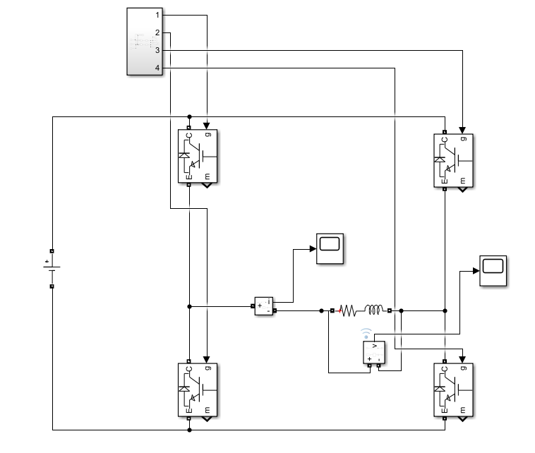
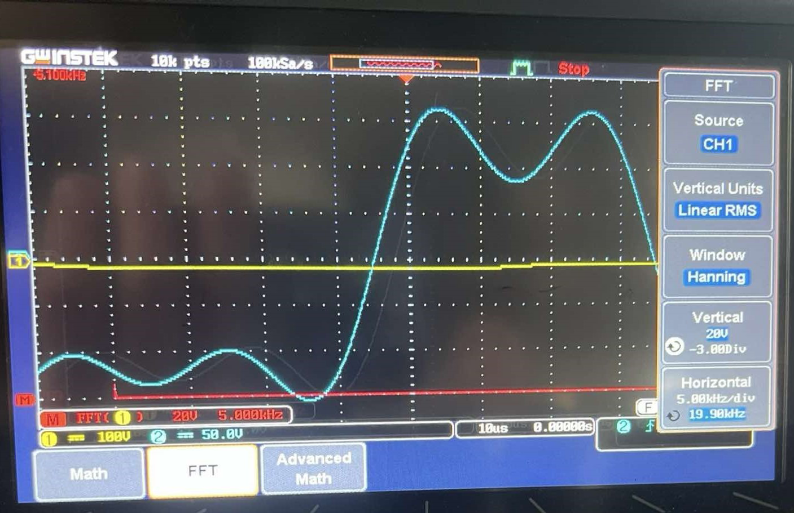

# Inverter Modulation and PWM

Practical implementation and comparison of inverter modulation strategies: square-wave, phase-shifted and two-/three-level sinusoidal PWM. I analysed voltage and current waveforms, RMS values and harmonic spectra in the laboratory and in Simulink.

## Practical implementation and experimental validation

- Implemented and compared inverter modulation strategies during laboratory experiments.
- Recorded voltage/current waveforms and spectra for square-wave and phase-shifted operation.
- Compared two-level and three-level sinusoidal PWM waveforms.
- Analysed RMS voltage, the fundamental component and total harmonic distortion (THD).
- Investigated modulation-index, switching-frequency and load-inductance effects, and compared measurements with Simulink results.

### Simulation circuit

### Experimental waveform capture

Oscilloscope measurements from the practical work. Circuit settings and measurement conditions are given in the report.

## Repository contents

| File | Purpose |
| --- | --- |
| [inverter-pwm-report-fr.pdf](inverter-pwm-report-fr.pdf) | Full French report: experimental setup, measurements, calculations and simulation comparisons. |
| [results-and-waveforms.zip](results-and-waveforms.zip) | Circuit diagrams, waveforms and spectra. |
| [simulation-diagram.png](simulation-diagram.png) | Simulation circuit diagram. |
| [inverter_pwm.slx](inverter_pwm.slx) | Editable Simulink model. |

## Getting started

1. Read the French report to understand the circuit, operating conditions and measurement protocol.
2. Extract `results-and-waveforms.zip` to inspect the recorded results and simulation figures.
3. Open `inverter_pwm.slx` in MATLAB/Simulink and inspect the configured circuit and parameters before running it.
4. Use the report to select the operating case to reproduce and compare the voltage/current waveforms.

## Software requirements

MATLAB, Simulink and the power-system blocks used in the circuit model.

## Project context

Power-electronics group project completed at the National Polytechnic School of Algiers in 2024/2025, combining practical laboratory work and simulation.

**Author:** Amani Mouaad  
**Supervision:** Pr. M. Mahmoudi and Mr. Benachour.

The report is in French.
